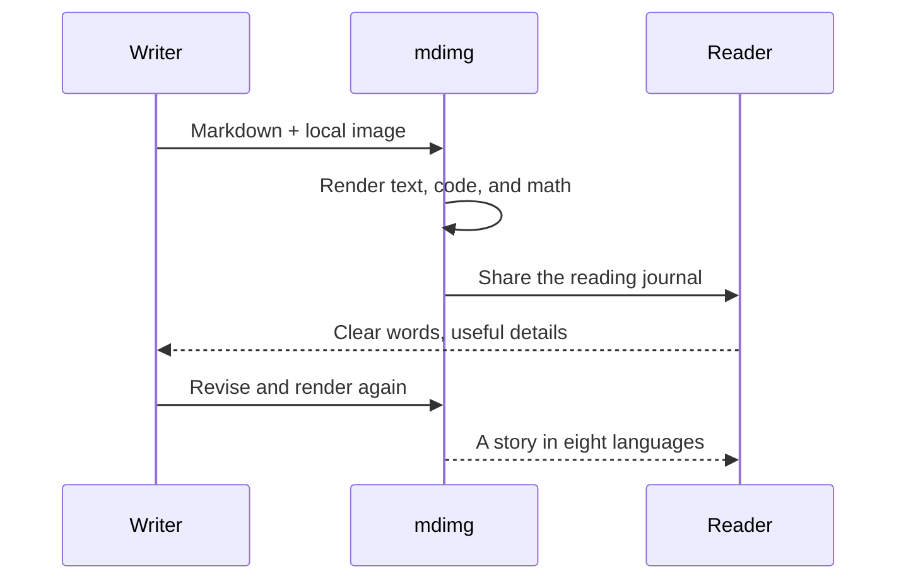

# Mdimg - Covert Markdown to image

## Marked


Markdown turns plain text into a readable document with a small set of familiar conventions. With [Marked] handling the structure and **mdimg** producing the image, the same article can combine thoughtful prose, practical checklists, concise code, mathematical notation, and diagrams. The examples below use local images and complete paragraphs so that each theme has meaningful content to display across the available width.

> The overriding design goal for Markdown's
> formatting syntax is to make it as readable
> as possible. The idea is that a
> Markdown-formatted document should be
> publishable as-is, as plain text, without
> looking like it's been marked up with tags
> or formatting instructions.
>
> > It's easy. It's not overly bloated, unlike HTML.
> > As the creator of [markdown] says.

## Daily Writes

### Emphasis, Code, and Escapes

Use **bold text for a key conclusion**, _italic text for a gentle emphasis_, and _**bold italic text when both are needed**_. An earlier ~~unfinished outline~~ can become a carefully edited article.

Literal punctuation can be written as \*asterisks\*, \_underscores\_, \[brackets\], and \# a hash sign. A code span can even include a backtick: ``const label = `Hello, world`;``.

This line ends with a backslash, creating a clear line break. \
The next line stays in the same paragraph, like a second line in a letter.

### Lists and Checklists

A list is a collection of names, items, numbers, or pieces of information written or displayed sequentially, typically with a single entry on each line.

- **Observe carefully：** record the place, the people, and the small details that make the scene memorable.
- **Organize the material：** group related notes into paragraphs, keep a consistent order, and explain unfamiliar names before relying on them in later sections.
  - Preserve the original wording of a quotation, together with its source and the context in which it was spoken.
  - Write clearly about personal feelings and verifiable facts, and then connect the two with natural transitions, allowing readers to know which are observations and which are explanations.
- **Review the draft：** read it aloud, remove repeated phrases, and replace vague claims with an example that a new reader can understand.

A checklist is a structured list of tasks, items, or criteria that you write down and check off to make sure you do not forget anything or miss a critical step.

1. Prepare a workspace with a notebook, local reference images, and the Markdown source so that everything needed for the article is close at hand.
   - [x] Proofread the English master copy for engaging storytelling, tone, and correct grammar.
   - [x] Collect the English, 中文、日本語 and 한국어 passages before applying the final formatting.
   - [ ] Apply consistent Markdown syntax (H2/H3 headings, bolding, italics, blockquotes) across all language sections.
   - [ ] Insert horizontal rules `---` or clear visual dividers between the different language versions.
2. Build the article in a clear order, moving from an introduction to observations, supporting material, and a practical conclusion.
   1. Check names, dates, measurements, and quotations against the original notes.
   2. Add tables, code, or diagrams only where they explain something useful.
      - Keep a table cell concise enough to scan, while giving ordinary prose enough space to form a complete thought.
3. Render the document and review the result, paying attention to line wrapping, image placement, paragraph rhythm, and the relationship between headings and their text.

### Tables

A table is a flat horizontal surface supported by legs used for eating, working, or holding objects, as well as a structured arrangement of data in rows and columns.

| Language |                                Phrase                                |              Detail |
| :------- | :------------------------------------------------------------------: | ------------------: |
| English  |                     **Hear... Feel... Think...**                     |         1,024 words |
| 简体中文 |                     你说水星它没有卫星、好孤独。                     |           上午 9:30 |
| 繁體中文 |                當世事再無完美，可遠在歲月如歌中找你。                |      談戀愛、遊天地 |
| Español  |                 A veces se gana, a veces se aprende.                 | á, é, í, ó, ú, ü, ñ |
| Français |                        Mon cœur. Bon voyage !                        | à, â, ç, é, è, ê, œ |
| Deutsch  |                      Jetzt haben wir den Salat.                      |  ä, ö, ü, ß; €19,50 |
| 日本語   | 「あと１歩進む力があったら、この世界を……すべての世界を、救えるか？」 |      漢字・ひらがな |
| 한국어   |                    당신 같은 어른이 제일 싫습니다                    |         당어싫, 85% |

## Code and Structured Notes

A code fence preserves indentation and punctuation while its language label guides syntax highlighting. A structured note is a hybrid financial security issued by a bank or financial institution.

```ts
interface JournalEntry {
  language: string;
  title: string;
  reviewed: boolean;
}

const entries: JournalEntry[] = [
  { language: "en", title: "A world of words", reviewed: true },
  { language: "zh-CN", title: "文字的世界", reviewed: true },
  { language: "ja", title: "言葉をつなぐ旅", reviewed: false },
  { language: "ko", title: "함께 읽는 이야기", reviewed: false },
];

const ready = entries.filter((entry) => entry.reviewed);
console.log(ready.map(({ language, title }) => `${language}: ${title}`));
```

## LaTex

With single-dollar inline math enabled, a short expression such as $E = mc^2$ can sit beside ordinary prose, and $\dfrac{0}{1} \neq \infty$ shows how fractions and symbols interact with the surrounding line.

<div>$$
A_{m,n} =
\begin{pmatrix}
a_{1,1} & a_{1,2} & \cdots & a_{1,n} \\
a_{2,1} & a_{2,2} & \cdots & a_{2,n} \\
\vdots & \vdots & \ddots & \vdots \\
a_{m,1} & a_{m,2} & \cdots & a_{m,n}
\end{pmatrix}
\qquad
\sum_{k=1}^{n} k = \frac{n(n+1)}{2}
$$</div>

<div>$$
\int_0^1 x^2\,\mathrm{d}x = \frac{1}{3}
\qquad
f(x) = \begin{cases}
x^2, & x \geq 0, \\
-x, & x < 0.
\end{cases}
$$</div>

## Mermaid

A sequence diagram can explain the relationship between writing, rendering, and review without repeating the whole process in prose.



[marked]: https://github.com/markedjs/marked/
[markdown]: https://daringfireball.net/projects/markdown/
