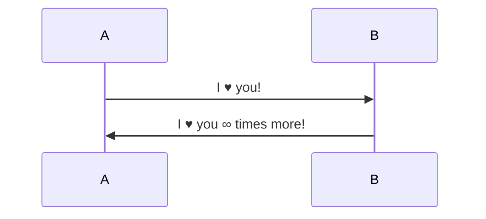

# Mdimg - Covert Markdown to image

## Marked


[Marked] lets you convert [Markdown] into HTML. Markdown is a simple text format whose goal is to be very easy to read and write, even when not converted to HTML. This demo page will let you type anything you like and see how it gets converted. Live. No more waiting around. Why Markdown?

It's easy. It's not overly bloated, unlike HTML. Also, as the creator of [markdown] says,

> The overriding design goal for Markdown's
> formatting syntax is to make it as readable
> as possible. The idea is that a
> Markdown-formatted document should be
> publishable as-is, as plain text, without
> looking like it's been marked up with tags
> or formatting instructions.

[marked]: https://github.com/markedjs/marked/
[markdown]: http://daringfireball.net/projects/markdown/

## Table

| Syntax    | Description |         Test Text |
| :-------- | :---------: | ----------------: |
| Header    |    Title    |       Here's this |
| Paragraph |    Text     |          And more |
| **Bold**  |  _Italic_   | ~~Strikethrough~~ |
| [Link](#) |   `Code`    |          $E=mc^2$ |

## Mixed Nested Lists

1. Install dependencies
   - Node.js v18+
   - npm or yarn
2. Configure environment
   1. Copy `.env.example` to `.env`
   2. Update database credentials
      - Host: `localhost`
      - Port: `5432`
3. Run the application
   - [x] Development mode: `npm run dev`
   - [ ] Production build:
     1. Execute `npm run build`
     2. Start server with `npm start

## LaTex

This is a inline LaTex example: $\dfrac{0}{1} \neq \infty$. And below is a block LaTeX example:

<div>$$
A_{m,n} =
\begin{pmatrix}
a_{1,1} & a_{1,2} & \cdots & a_{1,n} \\
a_{2,1} & a_{2,2} & \cdots & a_{2,n} \\
\vdots & \vdots & \ddots & \vdots \\
a_{m,1} & a_{m,2} & \cdots & a_{m,n}
\end{pmatrix}
$$</div>

## Code Block

```html
<h1>This is a top level heading</h1>

<span style="font-size: 32px; margin: 21px 0; display: block;">
  Is this a top level heading?
</span>
```

```ts
interface User {
  id: number;
  firstName: string;
  lastName: string;
  role: string;
}

function updateUser(id: number, update: Partial<User>) {
  const user = getUser(id);
  const newUser = { ...user, ...update };
  saveUser(id, newUser);
}
```

## Mermaid


